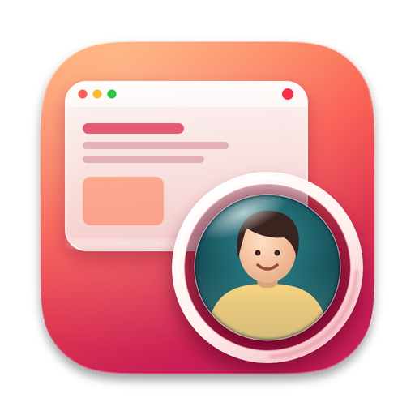

<p align="center">
  
</p>

<h1 align="center">StreamBubble</h1>

<p align="center">
  <strong>Record your screen with your face in it. One shortcut, no account, no upload.</strong>
</p>

<p align="center">
  <a href="LICENSE"></a>
  
  
</p>

---

StreamBubble is a tiny Mac menu bar app for the quick video walkthrough: the bug repro, the
code review, the "here's how it works" for a teammate. Press a shortcut, talk, press it
again. You get an `.mp4` of your screen with your face in a round bubble, saved right to
your Mac.

There is no sign-in, no cloud, and no subscription. Your recordings never leave your
computer.

## Why StreamBubble

🎬 **Hit record from anywhere.** <kbd>Hyperkey</kbd>+<kbd>L</kbd> starts and stops. A 3-2-1
countdown gives you a beat to get ready. <kbd>Hyperkey</kbd>+<kbd>P</kbd> pauses, and the
pause leaves no gap in the video.

🫧 **A face bubble you control.** Drag it anywhere. Click it to change its size, from a subtle
140 pt to a 600 pt talking head. Give it a white ring, a soft drop shadow, both, or neither.

🌫️ **Blur your background.** StreamBubble works with the macOS Portrait effect, and its
slider sets how much blur you get. Nobody needs to see the laundry.

✂️ **Record the whole screen, or just a part.** Drag out a region and only that part goes in
the video. The bubble moves in to stay with you.

🖱️ **Every click shows.** The cursor is in the video, with a ring at each click, so viewers
can follow along.

🔒 **Private by design.** No account, no server, no analytics. The video goes to
`~/Movies/StreamBubble/`, and Finder opens on it when you stop.

🪶 **Small and native.** A menu bar icon and the bubble, built on ScreenCaptureKit and
AVFoundation. No Electron, and no Dock icon.

## Get started

StreamBubble builds from source. You need macOS 15 or later, Xcode 16 or later, and
[XcodeGen](https://github.com/yonaskolb/XcodeGen).

```bash
brew install xcodegen
git clone https://github.com/chardigio/streambubble.git
cd streambubble
DEVELOPMENT_TEAM=<your team ID> scripts/install.sh
```

Find your team ID in Xcode > Settings > Accounts. A free personal team works. The script
builds the app, puts it in `/Applications`, and opens it.

On the first launch, macOS asks for the camera, the microphone, and screen recording. After
you allow screen recording, quit StreamBubble and open it again (macOS applies that permission
only at launch).

## Cheat sheet

| To... | Do this |
|---|---|
| Start or stop a recording | <kbd>Hyperkey</kbd>+<kbd>L</kbd> (that's <kbd>⌘</kbd><kbd>⌃</kbd><kbd>⌥</kbd><kbd>⇧</kbd><kbd>L</kbd>) |
| Pause or resume | <kbd>Hyperkey</kbd>+<kbd>P</kbd> |
| Cancel the countdown | <kbd>Hyperkey</kbd>+<kbd>L</kbd> again |
| Move the bubble | Drag it |
| Change the bubble size | Click it, or pick a size in the menu |
| Get every option next to the bubble | Right-click the bubble |
| Record only part of the screen | Menu > Record > Region…, then drag |
| Pick the video quality | Menu > Quality: High (HEVC, 60 fps), or Standard (H.264, 30 fps) for a file that must play everywhere |
| Blur the background | Menu > Blur Background…, then turn on Portrait |
| Find your videos | Menu > Open Recordings Folder |

No hyperkey? Press all four modifier keys together, or map Caps Lock to them with a tool like
[Hyperkey](https://hyperkey.app) or [Karabiner-Elements](https://karabiner-elements.pqrs.org).

## Contribute

Pull requests are welcome. See [CONTRIBUTING.md](CONTRIBUTING.md) for the code layout, how
it works under the hood, and how to run the tests.

## License

[MIT](LICENSE) © Charlie DiGiovanna
